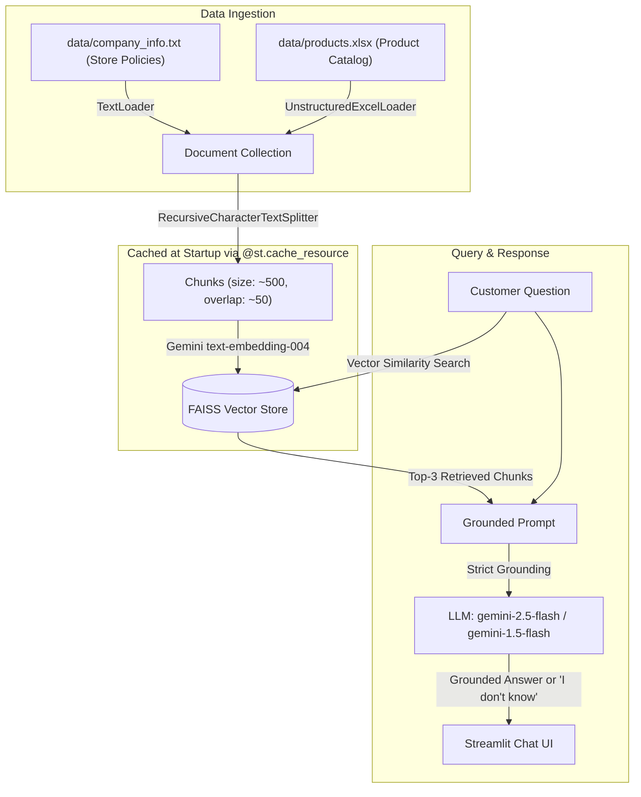

# Project 2 — RAG-Based E-Commerce Custom Chatbot with Streamlit

An enterprise-grade Retrieval-Augmented Generation (RAG) assistant for **Lumina Direct** (E-Commerce Store). The chatbot loads local store policies (`.txt`) and product inventory catalogs (`.xlsx`) at startup, indexes them into a **FAISS** vector store using **Google Gemini** embeddings, and answers customer queries strictly based on store data.

---

## 🏗️ Architecture & RAG Pipeline



---

## 📁 Project Structure

```
12- RAG Chatbot/
├── app.py                  # Streamlit chat interface with @st.cache_resource
├── rag.py                  # LangChain loaders, text splitter, FAISS & Gemini RAG chain
├── create_excel_data.py    # Script generating data/products.xlsx catalog
├── requirements.txt        # Pinned Python package dependencies
├── .env.example            # Environment variables template
├── .env                    # Local environment variables (GEMINI_API_KEY)
└── data/
    ├── company_info.txt    # E-commerce store shipping, return, warranty & payment policies
    └── products.xlsx       # E-commerce product catalog (SKUs, specs, prices, stock, ratings)
```

---

## 🚀 Setup & Execution

### 1. Configure Your Gemini API Key
Add your Gemini API key to the `.env` file:
```env
GEMINI_API_KEY=your_gemini_api_key_here
```
*(You can also enter your key directly into the Streamlit sidebar).*

### 2. Run the Streamlit Application
Activate the virtual environment and run the app:
```bash
# Windows PowerShell
.\.venv\Scripts\Activate.ps1
streamlit run app.py
```
*(Or directly: `.\.venv\Scripts\streamlit.exe run app.py`)*

---

## ✨ Required Features Implemented

| Requirement | Implementation Detail |
|---|---|
| **E-Commerce Store Domain** | Custom store policies (shipping, returns, warranty, BNPL) + 10 rich electronics/smart home products. |
| **Data Loading** | `TextLoader` for `.txt` policies and `UnstructuredExcelLoader` for `.xlsx` catalog. Combined before chunking. |
| **Chunking** | `RecursiveCharacterTextSplitter` with `chunk_size=500` and `chunk_overlap=50`. |
| **Vector Store** | `FAISS` with `models/text-embedding-004` (Gemini) embeddings. |
| **Startup Caching** | `@st.cache_resource` loads and indexes documents **once at startup**, avoiding re-embedding on every query. |
| **Top-3 Chunk Retrieval** | Vector similarity retrieves the top-3 most relevant chunks per query. |
| **Strict Grounding** | LLM answers only from store documents. If information is absent, responds **"I don't know"**. |
| **Clean Streamlit UI** | Interactive chat with message history (`st.session_state`), sidebar settings, sample queries, and expandable chunk inspection. |
| **AI Provider** | Native **Google Gemini** integration (`langchain-google-genai`) with optional OpenAI toggle. |
