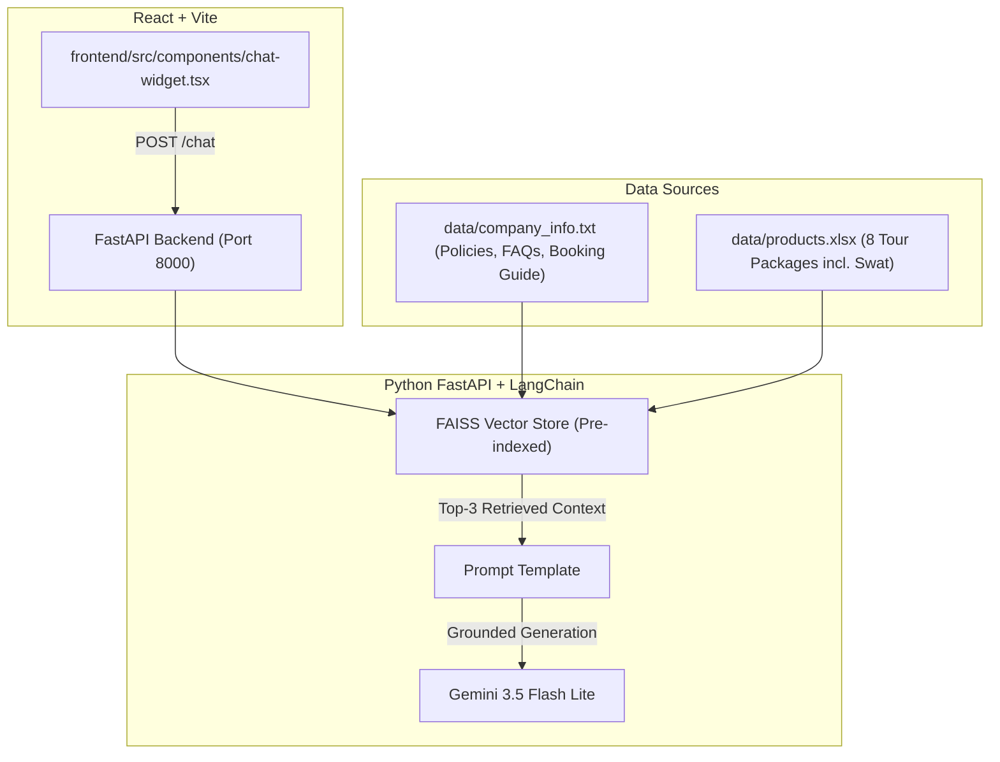

# Roamora Travels — AI RAG Chatbot & Backend API

An enterprise Retrieval-Augmented Generation (RAG) travel assistant for **Roamora Travels**. Grounded strictly in company policy documents (`.txt`) and curated tour package catalogs (`.xlsx`), the chatbot answers traveler inquiries with zero hallucination and warm, professional customer service guidance.

---

## 🏗️ Architecture Overview



---

## 📁 Repository Structure

```
12- RAG Chatbot/
├── api.py                  # FastAPI REST backend with CORS & startup index caching
├── rag.py                  # LangChain loaders, FAISS vector store, Gemini pipeline
├── create_excel_data.py    # Generates data/products.xlsx tour catalog
├── requirements.txt        # Pinned Python package dependencies
├── render.yaml             # 1-Click Render blueprint configuration
├── Procfile                # Web process definition for Railway/Heroku
├── .env.example            # Environment variable template
├── .env                    # Local environment secrets (GEMINI_API_KEY)
├── context.md              # Project handover, status & deployment notes
├── data/
│   ├── company_info.txt    # Policies, step-by-step booking guide & FAQs
│   └── products.xlsx       # Tour package catalog (Hunza, Skardu, Swat, Dubai, Bali, etc.)
└── frontend/               # Lovable React + Vite frontend with ChatWidget
```

---

## 🚀 Quickstart: Running Locally

### 1. Backend (FastAPI)
```powershell
# Navigate to project root
cd "d:\Projects\12- RAG Chatbot"

# Activate environment & start server
.\.venv\Scripts\python.exe -m uvicorn api:app --host 127.0.0.1 --port 8000 --reload
```
* Interactive API Docs: [http://localhost:8000/docs](http://localhost:8000/docs)
* Health Endpoint: [http://localhost:8000/health](http://localhost:8000/health)

### 2. Frontend (React + Vite)
```powershell
cd "d:\Projects\12- RAG Chatbot\frontend"
npm run dev
```
* Web App Preview: [http://localhost:8080](http://localhost:8080)

---

## ☁️ Cloud Deployment (Render / Railway)

### 1. Push Backend to GitHub
Create a GitHub repository (e.g. `roamora-rag-backend`) and push the root folder:
```powershell
git add .
git commit -m "feat: Roamora Travels FastAPI RAG backend"
git remote add origin https://github.com/<your-username>/roamora-rag-backend.git
git branch -M main
git push -u origin main
```

### 2. Deploy on Render
1. Go to [Render Dashboard](https://dashboard.render.com/) -> **New Web Service**.
2. Connect your `roamora-rag-backend` repository.
3. Configure settings (or let `render.yaml` configure automatically):
   * **Runtime:** Python 3
   * **Build Command:** `pip install -r requirements.txt`
   * **Start Command:** `uvicorn api:app --host 0.0.0.0 --port $PORT`
4. In **Environment Variables**, add:
   * `GEMINI_API_KEY`: `your_gemini_api_key`
5. Click **Create Web Service**. Your API will be live at `https://<service-name>.onrender.com`.

### 3. Connect Frontend to Live Backend
In [`frontend/src/components/chat-widget.tsx`](file:///d:/Projects/12-%20RAG%20Chatbot/frontend/src/components/chat-widget.tsx#L26), set `VITE_API_URL` or update the fallback URL:
```typescript
const API_BASE_URL = (import.meta.env as Record<string, string | undefined>)["VITE_API_URL"] || "https://your-backend-app.onrender.com";
```
Commit and push to the frontend repo, and your live Lovable site will connect automatically to the cloud AI assistant!
